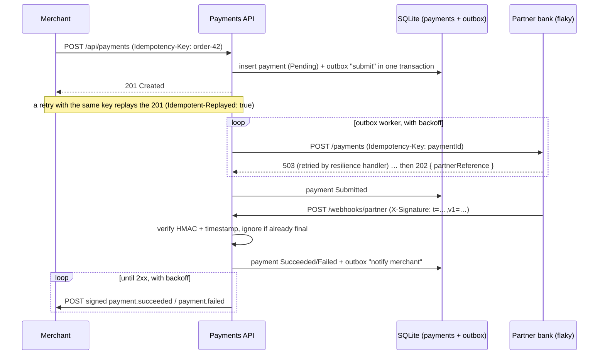

# Payments Integration Hub

[](https://github.com/Al7assan1999/payments-integration-hub/actions/workflows/ci.yml)

A payment service in **ASP.NET Core (.NET 10)** that sits between merchants and a partner bank, built to show the patterns that keep integrations correct when networks fail, requests are retried and messages arrive twice:

| Pattern | Where | What it prevents |
|---|---|---|
| **Idempotency keys** | `POST /api/payments` ([`IdempotencyFilter`](src/Payments.Api/Idempotency/IdempotencyFilter.cs)) | A client retrying after a timeout creating a second payment |
| **Resilient outbound calls** | [`PartnerClient`](src/Payments.Api/Integration/PartnerClient.cs) + `Microsoft.Extensions.Http.Resilience` | Transient partner errors failing payments; hammering a partner that is down (circuit breaker) |
| **End-to-end idempotency** | Payment id sent as the partner's `Idempotency-Key` | Retries of the outbound POST charging the customer twice |
| **Transactional outbox** | [`OutboxProcessor`](src/Payments.Api/Integration/OutboxProcessor.cs) | A payment saved but never submitted, or a status change the merchant never hears about |
| **Exponential backoff + dead-lettering** | Outbox retries: 2s, 4s, 8s … capped at 5 min, 8 attempts | Retry storms; messages retried forever |
| **Signed webhooks (HMAC-SHA256)** | [`WebhookSignature`](src/Payments.Webhooks/WebhookSignature.cs), incoming and outgoing | Forged callbacks; replays of captured requests (timestamp tolerance); timing attacks (constant-time compare) |
| **Duplicate-safe webhook handling** | `/webhooks/partner`, merchant `EventId` | A redelivered callback notifying the merchant twice |

## How a payment flows



## Repository layout

```
src/
  Payments.Api/        Merchant API, partner webhook receiver, outbox worker
  Payments.Webhooks/   Signing + wire contracts shared by all three apps
  PartnerBank.Mock/    Partner simulator: random 503s, idempotent, async signed callbacks, declines amounts ending .99
  MerchantSite.Mock/   Merchant simulator: verifies signatures, rejects each event's first delivery, dedupes by EventId
tests/Payments.Tests/  Signature, idempotency, resilience, outbox and webhook tests
deploy/e2e.sh          End-to-end script run in CI
```

## Running it

```bash
docker compose up --build
bash deploy/e2e.sh      # needs curl and jq
```

| Service | URL |
|---|---|
| Payments API | http://localhost:5300 (OpenAPI at `/openapi/v1.json`) |
| Partner bank simulator | http://localhost:5301 (`/stats` shows requests, injected failures, deduplications) |
| Merchant simulator | http://localhost:5302 (`/events` shows what the merchant received) |

Without Docker, run the three projects with `dotnet run` (ports 5300–5302 are preconfigured).

Output from a CI run, with the partner failing 30% of requests and the merchant failing every first delivery:

```
== Idempotency: the same key twice returns the same payment
   same id, replay header present
== Reusing a key with a different body is rejected (422)
== Waiting for every payment to reach a final status
   all final; the .99 payment was declined with the partner's reason
== Partner stats (injected failures were retried)
{"injectedFailures":2,"requests":12}
== Merchant received exactly one event per payment, all correctly signed
{"deliveries":20,"rejectedSignatures":0,"events":10}
All end-to-end checks passed.
```

## Tests

`dotnet test` runs 19 tests in a few seconds, including the API in-process with stubbed partner/merchant HTTP and a fake clock to step through backoff schedules:

- same key → same payment and a single partner submission; reused key with a different body → 422
- partner 503s are retried by the resilience handler, then rescheduled by the outbox with backoff, then succeed
- a partner that never recovers → message dead-lettered, payment failed, merchant notified
- a partner 4xx → failed immediately, no retries
- forged partner callbacks → 401; redelivered callbacks → applied once, merchant notified once
- merchant webhooks are signed and retried until a 2xx

CI also runs the end-to-end script against the three containers.

## Production notes

Deliberate simplifications, each with its upgrade path:

- **SQLite** keeps the demo dependency-free; the EF Core model works on SQL Server or PostgreSQL unchanged.
- **Single outbox worker**: multiple instances would claim rows with `SELECT … FOR UPDATE SKIP LOCKED` (PostgreSQL) or `READPAST` (SQL Server).
- **Idempotency records** are kept forever here; production would expire them (typically after 24 hours).
- **One merchant**: the webhook URL and secret would move to a per-merchant table with secret rotation.

## License

MIT
